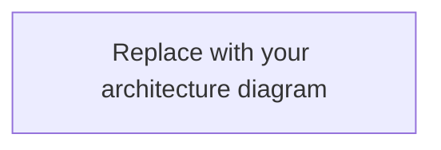

# 02. Software Architecture Design

> **Owner:** User / project director. **Purpose:** Capture the full-stack architecture and its important boundaries. **Editing rule:** Claude treats this file as read-only unless explicitly asked to edit it.
>
> **How to fill:** Complete Part A first; refine Part B in later iterations. Groups marked **(one)** take a single choice; others allow several.
> **Values:** `[x]` selected · blank = unknown · `Claude proposes` = delegated to the plan · `N/A` = not applicable · `Later` = deferred.
>
> This file owns infrastructure choices, including queues, workflow engines, streaming transport, LLM provider, and agent framework. `03-DESIGN_AGENT_WORKFLOW.md` refers here rather than repeating them.

---

# Part A: Essentials

## 1. System summary

In 2–4 sentences: the major components and how a request and its data move through the system. If you provide the diagram below, one or two sentences are enough.

_Write here:_

### Architecture diagram (optional, recommended)

Replace the placeholder with a Mermaid diagram of the overall system: clients, services (including the agent service), data stores, external integrations, and the main request flow. Label the arrows with the protocol or purpose. The agent's internal structure belongs in `03-DESIGN_AGENT_WORKFLOW.md`, section 3.

## 2. Architecture style (one)

- [ ] Modular monolith
- [ ] Client application with backend API
- [ ] Serverless functions
- [ ] Multiple services
- [ ] Other:

## 3. Technology choices

| Area | Choice | Flexibility (one) |
|---|---|---|
| Frontend | | [ ] Fixed [ ] Open to suggestions [ ] Claude proposes |
| Backend | | [ ] Fixed [ ] Open to suggestions [ ] Claude proposes |
| Primary database | | [ ] Fixed [ ] Open to suggestions [ ] Claude proposes |
| LLM provider(s) | | [ ] Fixed [ ] Open to suggestions [ ] Claude proposes |
| Agent framework / orchestration | | [ ] Fixed [ ] Open to suggestions [ ] Claude proposes |
| Hosting / run target | | [ ] Fixed [ ] Open to suggestions [ ] Claude proposes |
| Other | | [ ] Fixed [ ] Open to suggestions [ ] Claude proposes |

## 4. Identity and access

- **Authentication (one):** [ ] None for local demo [ ] Email / password [ ] OAuth / social [ ] Enterprise SSO [ ] Managed identity provider [ ] Other:
- **Authorization:** [ ] No protected roles [ ] Role-based (RBAC) [ ] Resource ownership checks [ ] Attribute-based (ABAC) [ ] Other:
- **Tenant model (one):** [ ] Single user [ ] Single organization [ ] Multi-tenant [ ] N/A

## 5. External integrations

| Integration / provider | Purpose | Required now? | Mock acceptable? | Failure behavior |
|---|---|---|---|---|
| | | [ ] Yes [ ] Later | [ ] Yes [ ] No | |
| | | [ ] Yes [ ] Later | [ ] Yes [ ] No | |

## 6. Execution pattern

- **Primary request pattern (one):** [ ] Synchronous request / response [ ] Streaming response [ ] Background job [ ] Mixed
- **Long-running work (one):** [ ] Not needed [ ] In-process background task [ ] Queue + worker [ ] Durable workflow engine:
- **Streaming transport (one):** [ ] Not needed [ ] Server-Sent Events (SSE) [ ] WebSockets [ ] Polling [ ] Other:

A short request does not need a durable workflow engine. Work that must survive restarts, wait for people or timers, or resume after failure may need one.

**Part A ready for planning:** [ ]

---

# Part B: Detail (fill when relevant; blank fields use `00-REQUIREMENTS.md` answers, otherwise `Claude proposes`)

## 7. Components

| Component | Responsibility | Runs where | Depends on |
|---|---|---|---|
| Frontend | | | |
| Backend / API | | | |
| Agent service (if separate) | | | |
| Background worker (if any) | | | |

Extend the architecture diagram in section 1 rather than adding a second one.

## 8. Frontend

- **Application type (one):** [ ] Web [ ] Mobile [ ] Desktop [ ] CLI [ ] API only [ ] Other:
- **Rendering (one):** [ ] Client-rendered [ ] Server-rendered [ ] Static [ ] Mixed [ ] N/A
- **UI approach (one):** [ ] Component library: [ ] Custom components [ ] Minimal UI
- **State management:**
- **Accessibility / responsive requirements:**

## 9. Backend and API

- **API style (one):** [ ] REST [ ] GraphQL [ ] gRPC [ ] RPC / server actions [ ] Other:
- **API contract (one):** [ ] OpenAPI [ ] Schema-first [ ] Code-first [ ] Other:
- **Error format** (default: one consistent structured shape):
- **Rate limiting / request limits:**
- **Versioning needs:**

## 10. Data storage

- **Data model notes:**
- **Cache (one):** [ ] None [ ] In-process [ ] Redis [ ] Managed cache [ ] Other:
- **Search / vector retrieval (one):** [ ] None [ ] Database extension [ ] Dedicated vector store [ ] Search service [ ] Other:
- **File / object storage (one):** [ ] None [ ] Local for now [ ] S3-compatible / cloud object storage [ ] Other:
- **Backup and restore expectations:**

## 11. Identity details

- **Roles and permissions:**
- **Data isolation approach:**
- **Admin / privileged operations:**
- **Session and token handling:**

## 12. Integration details

- **Credential and secret management:**
- **Sandbox / mock approach for development:**
- **Webhook or callback verification:**

## 13. Background work and reliability

- **Queue / job technology:**
- **Durable workflow engine:**
- **Job state and recovery (one):** [ ] Not needed [ ] Persist job status [ ] Checkpoint and resume [ ] Full execution history
- **Timeouts, retries, and cancellation:**
- **Actions that must never happen twice:**

## 14. Deployment and environments

- **Environments:** [ ] Local [ ] Development [ ] Staging [ ] Production
- **Deployment model (one):** [ ] Single application [ ] Containers [ ] Serverless [ ] Multiple services [ ] Other:
- **CI / CD (one):** [ ] None [ ] Basic automated checks [ ] Build and deploy pipeline
- **Infrastructure as code (one):** [ ] Not needed [ ] Required [ ] Later
- **Configuration and secrets:**

## 15. Security and privacy

The baseline in `instructions/00-STANDARDS.md` always applies. Select project-specific additions:

- [ ] Audit log of important actions
- [ ] Encryption at rest beyond platform defaults
- [ ] Defined data retention and deletion
- [ ] Backups and tested recovery
- [ ] Upload type and size restrictions
- [ ] Other:

**Project-specific security / privacy notes:**

## 16. Observability

The delivery profile sets the default (`instructions/00-STANDARDS.md`). Record overrides or additions:

- **Logging / metrics / tracing:**
- **Error monitoring:**
- **Alerts or operational response:**

## 17. Testing

The delivery profile sets the default test depth. Record additions:

- **Critical paths that must be tested:**
- **Security / permission tests:**
- **Load / performance tests (one):** [ ] Not needed [ ] Required [ ] Later

## 18. Performance and scale

- **Expected initial users / workload:**
- **Target response time:**
- **Throughput / concurrency needs:**
- **Availability / recovery targets:**

## 19. Open questions and trade-offs

| Question / trade-off | Options considered | Current direction | Needs decision? |
|---|---|---|---|
| | | | [ ] Yes [ ] No |
