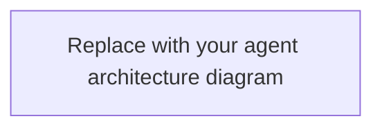

# 03. Agent and Agentic Workflow Design

> **Owner:** User / project director. **Purpose:** Define what the agentic system does, how it is structured, and the boundaries it operates within. Supports single-agent, multi-agent, and hybrid systems. **Editing rule:** Claude treats this file as read-only unless explicitly asked to edit it.
>
> **How to fill:** Complete Part A first; refine Part B in later iterations. Groups marked **(one)** take a single choice. Sections marked **Multi-agent** apply only to multi-agent or hybrid designs.
> **Values:** `[x]` selected · blank = unknown · `Claude proposes` = delegated to the plan · `N/A` = not applicable · `Later` = deferred.
>
> LLM provider, agent framework, queues, workflow engines, and streaming transport are chosen in `02-DESIGN_SOFTWARE.md`. Patterns and defaults are in `instructions/00-STANDARDS.md`, section 4.

---

# Part A: Essentials

## 1. Purpose

- **What the agentic part accomplishes for the user:**
- **Trigger:** [ ] User chat [ ] API request [ ] Schedule [ ] Event / webhook [ ] Internal workflow [ ] Other:
- **Who or what may trigger it:**
- **Input:**
- **Output or action:**

## 2. Workflow steps: code, model, or human

List the main steps. Use code for fixed logic and a model only for judgment or language.

| # | Step | Done by (one) | Notes |
|---|---|---|---|
| 1 | | [ ] Code [ ] Model [ ] Human | |
| 2 | | [ ] Code [ ] Model [ ] Human | |
| 3 | | [ ] Code [ ] Model [ ] Human | |

## 3. Agent structure (one)

- [ ] Single agent
- [ ] Multi-agent
- [ ] Hybrid (some flows single, some multi)
- [ ] Claude proposes

**Why this structure:**

### Agent architecture diagram (optional, recommended)

Replace the placeholder with a Mermaid diagram of the inside of the agent service: entry point, agents (or the single agent), tools, data they touch, human approval gates, handoffs, and the final output. It should match the agent cards (section 4) and the tools table (section 5). For multi-agent designs, show branch and handoff conditions on the arrows.

### Build scope

Same rules as the build scope table in `02-DESIGN_SOFTWARE.md`, section 1: agents, tools, data stores, and approval gates by their diagram names. Colours are only visual; a component not listed is proposed by Claude in the plan.

| Component | Scope (one) | Notes |
|---|---|---|
| | [ ] Build [ ] Mock [ ] Provided [ ] Later [ ] Out of scope | |
| | [ ] Build [ ] Mock [ ] Provided [ ] Later [ ] Out of scope | |

## 4. Agents

One card per agent. A single-agent system has one card. Copy the card for each additional agent.

### Agent: `<name>`
- **Responsibility:**
- **Out of scope:**
- **Mode (one):** [ ] Recommends only [ ] Acts
- **Tools / actions it may use:**
- **Data it may access:**
- **Hands off to / finishes when:**
- **Model or model profile:**

## 5. Tools and actions

| Tool / action | Purpose | Used by | Type (one) | Human approval? |
|---|---|---|---|---|
| | | | [ ] Read [ ] Write [ ] Consequential | [ ] Yes [ ] No |
| | | | [ ] Read [ ] Write [ ] Consequential | [ ] Yes [ ] No |

A consequential action is hard to reverse or affects people or systems outside the application: payments, sending messages, deleting data, external writes.

## 6. Limits

- **Maximum steps / tool calls per run:**
- **Maximum run time:**
- **Token or cost budget per run:**
- **Multi-agent: maximum delegation depth / agents per run:**
- **When a limit is reached (one):** [ ] Stop and return partial result with reason [ ] Escalate to a human [ ] Other:

## 7. Never allowed

Actions the system must never take, regardless of instructions or content.

-

## 8. Agentic scope

Capabilities beyond the components in the section 3 build scope table.

- **Required now:**
- **Later:**

**Part A ready for planning:** [ ]

---

# Part B: Detail (fill when relevant; blank fields use `00-REQUIREMENTS.md` answers, otherwise `Claude proposes`)

## 9. Topology and coordination (Multi-agent)

- **Topology:** [ ] Sequential pipeline [ ] Router [ ] Supervisor / worker [ ] Hierarchical [ ] Parallel + merge [ ] Collaborative [ ] Dynamic delegation within limits [ ] Other:
- **Coordination (one):** [ ] Direct handoff [ ] Shared workflow state [ ] Message passing [ ] Event-driven [ ] Shared task queue [ ] Other:
- **Shared context (one):** [ ] None [ ] Conversation-level [ ] Task-level [ ] Shared memory / knowledge [ ] Other:
- **Result aggregation:** [ ] Supervisor synthesis [ ] Passed to next agent [ ] Parallel merge [ ] Voting / consensus [ ] Rule-based selection [ ] Human selection [ ] Other:
- **Dynamic agent creation (one):** [ ] Not allowed [ ] Allowed within limits

**Flow, including branch and handoff conditions:** add them to the agent architecture diagram in section 3, or describe any that the diagram does not show:

_Write here:_

## 10. Handoff contracts (Multi-agent)

| From → To | Payload fields | Validation | Must not be passed |
|---|---|---|---|
| | | | |

## 11. Planning and execution

- **Execution style (one):** [ ] Fixed workflow [ ] Tool-use loop [ ] Dynamic planning [ ] Hybrid
- **Planning (one):** [ ] None [ ] Agent plans for itself [ ] Dedicated planner [ ] Supervisor plans
- **Execution order (one):** [ ] Sequential [ ] Parallel [ ] Conditional [ ] Mixed
- **Completion / stop conditions:**

## 12. Model strategy

- **Strategy (one):** [ ] One model for all agents [ ] Model per role [ ] Routed by task
- **Required capabilities:** [ ] Tool calling [ ] Structured output [ ] Vision [ ] Audio [ ] Long context [ ] Other:
- **Fallback model or behavior:**

## 13. Tool details

- **Tool interface:** [ ] Internal functions [ ] API / SDK [ ] MCP [ ] Workflow activities [ ] Other:
- **MCP servers, if any:**
- **Argument and output validation:**
- **Timeout and retry behavior:**
- **Duplicate action prevention (idempotency):**

## 14. Retrieval (RAG)

- **Retrieval needed (one):** [ ] No [ ] Yes [ ] Later
- **Sources:** [ ] Documents [ ] Database [ ] Search index [ ] APIs [ ] User files [ ] Other:
- **Method (one):** [ ] Keyword [ ] Vector [ ] Hybrid [ ] Structured queries [ ] Other:
- **Ingestion and update approach:**
- **Citations required (one):** [ ] Yes [ ] No [ ] Depends
- **Access control during retrieval:**
- **Behavior when nothing relevant is found:**

## 15. Memory and context

- **Conversation history (one):** [ ] None [ ] Current session [ ] Persistent
- **Long-term memory (one):** [ ] None [ ] Per user [ ] Shared / organizational
- **What may and must not be stored:**
- **Retention, correction, and deletion:**
- **Context window / summarization strategy:**

## 16. Agent state and durability

The job lifecycle (queue or workflow engine) is chosen in `02-DESIGN_SOFTWARE.md`. This section covers agent state only.

- **Agent state persistence (one):** [ ] In-memory per run [ ] Persist run state [ ] Durable checkpoints
- **Resume after interruption (one):** [ ] Not needed [ ] Required [ ] Depends on workflow
- **Human wait states / timers:**

## 17. User interaction and streaming

Transport is chosen in `02-DESIGN_SOFTWARE.md`.

- **What the user sees (one):** [ ] Final result only [ ] Token streaming [ ] Progress events [ ] Background status
- **Pause / cancel / resume controls:**
- **What the user sees when a run fails or hits a limit:**

## 18. Human-in-the-loop

- **Human role:** [ ] Review output [ ] Approve actions [ ] Supply missing information [ ] Resolve exceptions [ ] Other:
- **Who may approve:**
- **What the approver sees:**
- **Reject / edit / timeout behavior:**

## 19. Safety and permissions

Permissions are enforced in code, never only by prompts. Delegation never grants new permissions.

- **Enforcement point (one):** [ ] Backend service [ ] Tool gateway [ ] Policy layer [ ] Other:
- **Untrusted input and retrieved content handling:**
- **Prompt injection / malicious tool output handling:**
- **Sensitive data handling:**
- **Refusal and escalation conditions:**

## 20. Failure handling

- **Agent or tool timeout:**
- **Retry policy and maximum attempts:**
- **Model or specialist unavailable:**
- **Partial results:**
- **Multi-agent: conflicting results and cancellation propagation:**

## 21. Runtime prompts

- **Where prompts live:**
- **How prompt changes are versioned and tested:**

## 22. Evaluation

The delivery profile sets the minimum number of cases (`instructions/00-STANDARDS.md`).

| ID | Scenario / input | Expected behavior | Pass condition | Scope (one) |
|---|---|---|---|---|
| EVAL-001 | | | | [ ] Agent [ ] End-to-end |
| EVAL-002 | | | | [ ] Agent [ ] End-to-end |
| EVAL-003 | | | | [ ] Agent [ ] End-to-end |

Include at least one failure or refusal case. **Multi-agent** checks: [ ] Routing accuracy [ ] Handoff correctness [ ] Context transfer [ ] Aggregation quality [ ] No duplicate or conflicting actions [ ] Latency and cost across the agent group

## 23. Performance and cost targets

- **Target response latency:**
- **Cost budget per user or per day:**
- **Maximum parallel agents:**
- **Provider rate limits / concurrency:**
