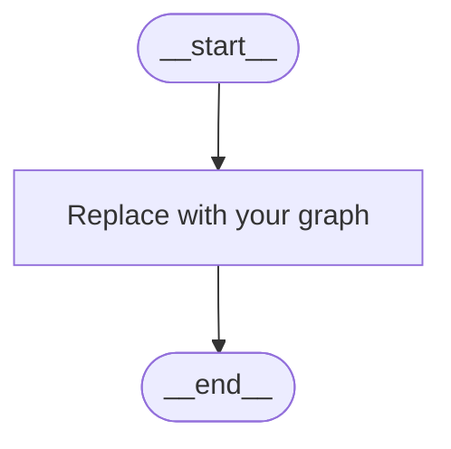

# Design

> Paste your design notes under these headings; skip what doesn't apply. Blank or `propose` lets the assistant propose. Assistants edit this file only on `CHANGE:`.

## 1. Problem statement

## 2. Constraints and stack

- **Given scaffold / toolkit (what, where):**
- **Model(s):**
- **Agent framework:** LangGraph + LangChain (default); note versions and any prebuilt agents used:
- **Run target** (notebook, API, Streamlit, local):
- **Python venv** (path; Python 3.13):
- **Observability:** Phoenix local (notebook) → Phoenix server URL (prod): ; Grafana demo dashboard: yes / no
- **Timebox:**

## 3. Agent graph (`__start__` to `__end__`)

| Node | Type | Does | Reads → writes (state) | Next / condition | Limits |
|---|---|---|---|---|---|
| | | | | | |

**Node types:** Memory & Context Loader (code) · Input Guardrail · FAQ / RAG Cache · Intent Router · Direct Response (LLM) · Tool-Calling Agent · Task Planner · Specialized Subagent · Human-in-the-Loop · Result Synthesizer (code / LLM) · Self-Correction / Eval (LLM / code) · Answer Formatter · Output Guardrail · Fallback / Refusal (code) · State & Memory Saver (code)

## 4. State object

| Field | Type | Set by | Persisted? |
|---|---|---|---|
| | | | |

## 5. Turn lifecycle (outside the graph)

- **On chat open / first message:** what is loaded, from where (cache, database).
- **After the graph run:** what is written, where.
- **Cache / summarize trigger** (e.g. intent changed and context limit exceeded):

## 6. Tools

| Tool | Does | Read / Write / Consequential | Approval needed? | Real / Mock / Provided |
|---|---|---|---|---|
| | | | | |

## 7. Data schemas (provided or proposed)

## 8. APIs (provided or proposed)

| Method and path | Request | Response | Notes |
|---|---|---|---|
| | | | |

## 9. Scope

| Component | Build · Mock · Provided · Later · Out | Notes |
|---|---|---|
| | | |

## 10. Rules and guardrails

Business rules, actions that are never allowed, HITL conditions, input and output guardrails.

-

## 11. Evals

| # | Input | Expected behavior | Pass if |
|---|---|---|---|
| 1 | | | |

### Conversation script (multi-turn)

One thread, up to 10 user turns. Responses come from running it; fill "Expected" only where it matters (e.g. "uses turn 2 context").

| Turn | User input | Expected (optional) |
|---|---|---|
| 1 | | |
| 2 | | |
| 3 | | |
| 4 | | |
| 5 | | |
| 6 | | |
| 7 | | |
| 8 | | |
| 9 | | |
| 10 | | |
